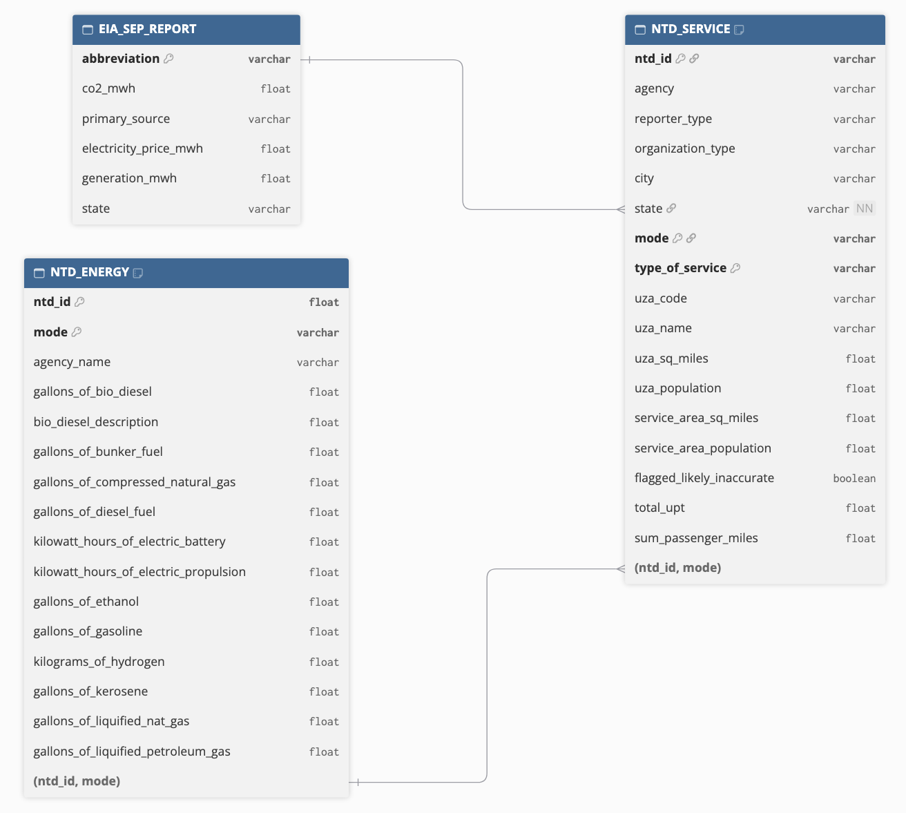

## Introduction

This project explores public transportation systems across the United States and their CO2 emissions. The goal is to identify and award prizes to the transit agencies who have achieved effective emission reductions.

The analysis utilizes data from two federal sources:

- Energy Information Administration (EIA)
- National Transit Database (NTD)

The analytics will include:

- Data Ingestion and Cleaning
- Data Combination and Manipulation
- Data Exploration and Statistical Analysis
- Data Visualization
- Awards Press Release

<br>

## Data Acquisition

#### Energy Information Administration: State Electricity Profiles
```{r}
#| code-fold: true
#| code-summary: "Show Code"
#| message: false

#This function will acquire data from the EIA SEP summary pages and create a tidy table for use

library(tidyverse)
library(stringr)
library(httr2)
library(rvest)
library(skimr)
library(dplyr)
library(gt)
library(ggplot2)

get_eia_sep <- function(state, abbr){
    library(tidyverse)
    library(stringr)
    library(httr2)
    library(rvest)
    library(fs)
  
    state_formatted <- str_to_lower(state) |> str_replace_all("\\s", "")
    
    dir_name <- fs::path("data", "mp02")
    file_name <- fs::path(dir_name, state_formatted)
    
    fs::dir_create(dir_name, recurse=TRUE)
    
    if(!fs::file_exists(file_name)){
        BASE_URL <- "https://www.eia.gov"
        RESPONSE <- request(BASE_URL) |> 
          req_url_path("electricity", 
                       "state", 
                       state_formatted) |>
          req_headers(
            `User-Agent` = "Mozilla/5.0 (Macintosh; Intel Mac OS X 10.15; rv:149.0) Gecko/20100101 Firefox/149.0"
            ) |>   
          req_retry(
                max_tries = 4, 
          ) |>
          req_perform(file_name)
    
        resp_check_status(RESPONSE)
    }
    
    TABLE <- read_html(file_name) |> 
        html_element("table") |> 
        html_table() |>
        mutate(Item = str_to_lower(Item))
    
    if("U.S. rank" %in% colnames(TABLE)){
        TABLE <- TABLE |> rename(Rank = `U.S. rank`)
    }
    
    CO2_MWh <- TABLE |> 
        filter(Item == "carbon dioxide (lbs/mwh)") |>
        pull(Value) |> 
        str_replace_all(",", "") |>
        as.numeric()
    
    PRIMARY <- TABLE |> 
        filter(Item == "primary energy source") |> 
        pull(Rank)
    
    RATE <- TABLE |>
        filter(Item == "average retail price (cents/kwh)") |>
        pull(Value) |>
        as.numeric()
    
    GENERATION_MWh <- TABLE |>
        filter(Item == "net generation (megawatthours)") |>
        pull(Value) |>
        str_replace_all(",", "") |>
        as.numeric()
    
    data.frame(CO2_MWh               = CO2_MWh, 
               primary_source        = PRIMARY,
               electricity_price_MWh = RATE * 10, # / 100 cents to dollars &
               # * 1000 kWh to MWH 
               generation_MWh        = GENERATION_MWh, 
               state                 = state, 
               abbreviation          = abbr
    ) |>
      rename(co2_mwh = `CO2_MWh`,
             electricity_price_mwh = `electricity_price_MWh`,
             generation_mwh = `generation_MWh`)
}

EIA_SEP_REPORT <- map2(state.name, state.abb, get_eia_sep) |> list_rbind()

skim(EIA_SEP_REPORT)
```
The `EIA_SEP_REPORT` data provides details about the electricity generation in each state across six variables. The entire data set is complete with no missing values.

<br>

#### National Transit Database: Energy Consumption
```{r}
#| code-fold: true
#| code-summary: "Show Code"
#| message: false
#| warning: false

#This function will acquire and download data from the annual database energy consumption report

load_ntd_energy <- function(){
  library(readxl)
  library(httr2)
  library(tidyverse)
  library(fs)
  
  # Create 'data/mp02' directory if not already present
  DATA_DIR <- fs::path("data", "mp02")
  fs::dir_create(DATA_DIR, recurse=TRUE)

  NTD_ENERGY_FILE <- fs::path(DATA_DIR, "2025_ntd_energy.xlsx")

  if(!fs::file_exists(NTD_ENERGY_FILE)){
    library(httr2)
  
    request("https://www.transit.dot.gov/") |>
      req_url_path("sites",
                   "fta.dot.gov",
                   "files",
                   "2026-09",
                   "2025 Energy Consumption_260806.xlsx") |> 
      req_headers(
        `User-Agent` = "Mozilla/5.0 (Macintosh; Intel Mac OS X 10.15; rv:149.0) Gecko/20100101 Firefox/149.0") |> 
      req_perform(NTD_ENERGY_FILE)
  }
  
  if(file.info(NTD_ENERGY_FILE)$size < 1e4){
        cat("I was unable to download the NTD Energy File. Please try again.\n")
        stop("Download failed. Please delete the corrupted file by running `unlink('data/mp02/2025_ntd_energy.xlsx')` and try again.")
    }

  to_numeric_fill_0 <- function(x){
    x <- if_else(x == "-", NA, x)
    replace_na(as.numeric(x), 0)
  }

  read_excel(NTD_ENERGY_FILE) |> 
    select(-c(`Reporter Type`, 
              `Reporting Module`, 
              `Gallons of Other Fuel`, 
              `Other Fuel Description`)) |>
    mutate(across(-c(`Agency Name`, 
                     `Mode`,
                     `TOS`), 
                  to_numeric_fill_0)) |>
    group_by(`NTD ID`, `Mode`, `Agency Name`) |>
    summarize(across(where(is.numeric), sum), 
              .groups = "keep") |>
    mutate(ENERGY = sum(c_across(c(where(is.numeric))))) |>
    filter(ENERGY > 0) |>
    select(-ENERGY) |>
    ungroup() |>
    rename(ntd_id = `NTD ID`,
           mode = `Mode`,
           agency_name = `Agency Name`,
           gallons_of_bio_diesel = `Gallons of Bio-Diesel`,
           bio_diesel_description = `Bio-Diesel Description`,
           gallons_of_bunker_fuel = `Gallons of Bunker Fuel`,
           gallons_of_compressed_natural_gas = `Gallons of Compressed Natural Gas`,
           gallons_of_diesel_fuel = `Gallons of Diesel Fuel`,
           kilowatt_hours_of_electric_battery = `Kilowatt hours of Electric Battery`,
           kilowatt_hours_of_electric_propulsion = `Kilowatt hours of Electric Propulsion`,
           gallons_of_ethanol = `Gallons of Ethanol`,
           gallons_of_gasoline = `Gallons of Gasoline`,
           kilograms_of_hydrogen = `Kilograms of Hydrogen`,
           gallons_of_kerosene = `Gallons of Kerosene`,
           gallons_of_liquified_nat_gas = `Gallons of Liquified Nat Gas`,
           gallons_of_liquified_petroleum_gas = `Gallons of Liquified Petroleum Gas`
           )
}

NTD_ENERGY <- load_ntd_energy()

skim(NTD_ENERGY)
```
The `NTD_ENERGY` data provides details about the type of fuel each transportation service in each public transportation agency uses.

<br>

#### National Transit Database: Transit Service
```{r}
#| code-fold: true
#| code-summary: "Show Code"
#| message: false

#This function acquires and downloads data from the 2025 Service by Agency report

load_ntd_service <- function(){
  library(httr2)
  library(tidyverse)
  library(fs)
  
  # Create 'data/mp02' directory if not already present
  DATA_DIR <- fs::path("data", "mp02")
  fs::dir_create(DATA_DIR, recurse=TRUE)

  NTD_SERVICE_FILE <- fs::path(DATA_DIR, "2025_ntd_service.csv")

  if(!fs::file_exists(NTD_SERVICE_FILE)){
    library(httr2)
  
    request("https://data.transportation.gov/resource/4fir-qbim.csv") |>
      req_url_query(`$query`=paste(
        "SELECT  `_5_digit_ntd_id` AS `NTD_ID`", 
        "`max_agency` AS `AGENCY`",
        "`max_reporter_type` AS `reporter_type`",
        "`max_organization_type` AS `organization_type`",
        "`max_city` AS `city`",
        "`max_state` AS `state`",
        "`mode`",
        "`type_of_service`",
        "`max_primary_uza_code` as `uza_code`",
        "`max_primary_uza_name` as `uza_name`",
        "`max_primary_uza_area_sq_miles` as `uza_sq_miles`",
        "`max_primary_uza_population` as `uza_population`",
        "`max_service_area_sq_miles` as `service_area_sq_miles`",
        "`max_service_area_population` as `service_area_population`",
        "`questionable_record` as `flagged_likely_inaccurate`",
        "`sum_unlinked_passenger_trips_upt` as `total_upt`",
        "`sum_passenger_miles` WHERE caseless_one_of(`report_year`, '2025') limit 50000", 
        sep=",")) |>
      req_headers(
        `User-Agent` = "Mozilla/5.0 (Macintosh; Intel Mac OS X 10.15; rv:149.0) Gecko/20100101 Firefox/149.0") |> 
      req_perform(NTD_SERVICE_FILE)
  }
  
  if(file.info(NTD_SERVICE_FILE)$size < 1e4){
        cat("I was unable to download the NTD Service File. Please try again.\n")
        stop("Download failed. Please delete the corrupted file by running `unlink('data/mp02/2025_ntd_service.xlsx')` and try again.")
    }

  read_csv(NTD_SERVICE_FILE) |>
    mutate(flagged_likely_inaccurate = !is.na(flagged_likely_inaccurate)) |>
    rename(ntd_id = `NTD_ID`,
           agency = `AGENCY`)
}

NTD_SERVICE <- load_ntd_service()

skim(NTD_SERVICE)
```
The `NTD_SERVICE` data includes information about the transportation service, including data surrounding service area, number of passenger trips, and number of passenger miles.

<br>

## Data Cleaning

Currently the `mode` columns in the `NTD` data are not user-friendly.
```{r}
#| code-fold: true
#| code-summary: "Show Code"

#Recode mode column to include easy interpretations of the mode codes

NTD_ENERGY <- NTD_ENERGY |>
    mutate(mode=recode_values(mode, 
        "HR" ~ "Heavy Rail", 
        "DR" ~ "Demand Response",
        "FB" ~ "Ferryboat",
        "MB" ~ "Bus",
        "SR" ~ "Streetcar Rail",
        "TB" ~ "Trolleybus",
        "VP" ~ "Vanpool",
        "CB" ~ "Commuter Bus",
        "RB" ~ "Bus Rapid Transit",
        "LR" ~ "Light Rail",
        "MG" ~ "Monorail and Automated Guideway modes",
        "CR" ~ "Commuter Rail",
        "AR" ~ "Alaska Railroad",
        "TR" ~ "Aerial Tramways",
        "YR" ~ "Hybrid Rail",
        "IP" ~ "Inclined Plane",
        "CC" ~ "Cable Car",
        default="Unknown"))


NTD_SERVICE <- NTD_SERVICE |>
    mutate(mode=recode_values(mode, 
        "HR" ~ "Heavy Rail", 
        "DR" ~ "Demand Response",
        "FB" ~ "Ferryboat",
        "MB" ~ "Bus",
        "SR" ~ "Streetcar Rail",
        "TB" ~ "Trolleybus",
        "VP" ~ "Vanpool",
        "CB" ~ "Commuter Bus",
        "RB" ~ "Bus Rapid Transit",
        "LR" ~ "Light Rail",
        "MG" ~ "Monorail and Automated Guideway modes",
        "CR" ~ "Commuter Rail",
        "AR" ~ "Alaska Railroad",
        "TR" ~ "Aerial Tramways",
        "YR" ~ "Hybrid Rail",
        "IP" ~ "Inclined Plane",
        "CC" ~ "Cable Car",
        default="Unknown"))
```
Therefore, a data cleaning step was performed to recode the `mode` column in both data sets into more easily understood descriptions The definitions of the original codes in the `mode` column were obtained from the NTD website.

<br>

## Data Exploration

#### State Electricity Profiles (SEP) Data

The bar chart below displays the five states with the highest average retail electricity price.
```{r}
#| code-fold: true
#| code-summary: "Show Code"

#Q1: Which 5 states have the most expensive retail electricity?

expensive_elec <- EIA_SEP_REPORT |>
  select(state, electricity_price_mwh) |>
  arrange(desc(electricity_price_mwh)) |>
  slice_max(electricity_price_mwh, n=5, with_ties = FALSE)

#Create graph to display results
ggplot(expensive_elec,
       aes(x = reorder(state, -electricity_price_mwh),
           y = electricity_price_mwh)) +
geom_col(fill = "steelblue") +
xlab("State") +
ylab("Average Retail Electricity Price(USD/MWh)") +
theme_bw() +
ggtitle("Top 5 States with the Most Expensive Retail Electricity") +
  labs(caption="Data provided by EIA SEP summary pages")

```
Hawaii currently has the most expensive retail electricity by a significant margin, while the following four states have similar prices. Hawaii's high electricity prices is likely due to its geographical location. Since Hawaii is heavily dependent on imported goods, the transportation cost and fluctuations in global fuel prices most likely increases prices.


In addition to having the highest average retail electricity price, Hawaii is the only state whose primary energy source as petroleum. 

```{r}
#| code-fold: true
#| code-summary: "Show Code"

#Q4: What are the three rarest primary energy sources in the US? What is the associated cost of electricity associated with each source and in what states are they used? (Table answer)

rare_source <- EIA_SEP_REPORT |>
  select(state, primary_source, electricity_price_mwh) |>
  group_by(primary_source) |>
  mutate(number_of_states = n_distinct(state)) |>
  ungroup() |>
  slice_min(number_of_states, n = 3, with_ties = TRUE) |>
  arrange(number_of_states, primary_source)

rare_source |>
  gt() |>
  cols_label(
    state = "State",
    primary_source = "Primary Energy Source",
    electricity_price_mwh = "Electricity Price (USD/MWh)",
    number_of_states = "Number of States") |>
  fmt_number(columns = electricity_price_mwh,
             decimals = 2) |>
  tab_header(title = "Three Rarest Primary Energy Sources in the U.S.") |>
  tab_source_note(source_note = "Data provided by EIA SEP summary pages")
```
The next two rarest primary energy sources are hydroelectric and wind, each as the primary energy source in four states.

When evaluating electricity generation, it is important to consider the carbon dioxide (CO2) emissions. The table below identifies the five states with the dirtiest electricity mix. This was established by considering the highest CO2 emissions per megawatt-hour (MWh) generated.
```{r}
#| code-fold: true
#| code-summary: "Show Code"

#Q2: Which 5 states have the ‘dirtiest’ electricity mix?

dirtiest_elec <- EIA_SEP_REPORT |>
  select(state, co2_mwh) |>
  arrange(desc(co2_mwh)) |>
  slice_max(co2_mwh, n=5, with_ties = FALSE)

#Create table to display results
dirtiest_elec |>
  gt() |>
  cols_label(state = "State",
             co2_mwh = "Pounds of CO2 Emissions per MWh of Electricity Produced") |>
  cols_align(align = "center") |>
  tab_header(title = "Top States with Dirtiest Electricity Mix") |>
  fmt_number(columns = co2_mwh, decimals = 0, use_seps = TRUE) |>
  tab_source_note(source_note = "Data provided by EIA SEP summary pages")
```

```{r}
#| code-fold: true
#| code-summary: "Show Code"

#Q3: On average, how many pounds of CO2 are emitted per MWh of electricity produced in the US?

avg_co2 <- EIA_SEP_REPORT |>
  mutate(total_emissions = co2_mwh * generation_mwh) |>
  summarize(total_generation_mwh = sum(generation_mwh, na.rm = TRUE),
            avg_co2_per_mwh = round(sum(total_emissions) / total_generation_mwh, 2)) |>
  pull(avg_co2_per_mwh)
```
In comparison to the top five states with the dirtiest mixes, the average CO2 emissions in the United States is `r avg_co2` pounds per MWh. This nation-wide average provides a useful benchmark for evaluating individual states.

To analyze electricity emissions across states, the energy mixes in Texas and New York can be compared. Texas is known for its dirty fossil fuels, while New York has made concerted efforts towards becoming the leader in clean energy.
```{r}
#| code-fold: true
#| code-summary: "Show Code"

#Q5:My home state, Texas, has a reputation as being the home of “dirty fossil fuels” while NY has a reputation as a leader in clean energy. How many times cleaner is NY’s energy mix than that of Texas? (Inline answer)

#Obtain New York's co2 emissions
ny_energy <- EIA_SEP_REPORT |>
  filter(state == 'New York') |>
  pull(co2_mwh)

#Obtain Texas' co2 emissions
tx_energy <- EIA_SEP_REPORT |>
  filter(state == 'Texas') |>
  pull(co2_mwh)

#Calculate New York's energy compared to Texas
state_energy_comparison <- round(tx_energy / ny_energy, 2)
```
Based on their respective emissions, New York's energy mix is `r state_energy_comparison` times cleaner than Texas' energy mix.

<br>

#### National Transit Database (NTD): Energy Consumption Data

To conduct an initial analysis of the NTD Energy Consumption Data, the five public transit agencies with the highest fuel consumption were identified. Total fuel usage was calculated by adding the reported gallons across nine fuel categories for each agency. The breakdown of the the fuel consumption by fuel type can be found in the table below.
```{r}
#| code-fold: true
#| code-summary: "Show Code"

#Q1: Which five transit agencies used the most gallons of fuel (all sources) and how did it breakdown by type?

#Calculate total fuel by type for each agency
agency_fuel_totals <- NTD_ENERGY |>
  group_by(agency_name) |>
  summarize(
    total_bio_diesel = sum(gallons_of_bio_diesel, na.rm = TRUE),
    total_bunker_fuel = sum(gallons_of_bunker_fuel, na.rm = TRUE),
    total_compressed_natural_gas = sum(gallons_of_compressed_natural_gas, na.rm = TRUE),
    total_diesel = sum(gallons_of_diesel_fuel, na.rm = TRUE),
    total_ethanol = sum(gallons_of_ethanol, na.rm = TRUE),
    total_gasoline = sum(gallons_of_gasoline, na.rm = TRUE),
    total_kerosene = sum(gallons_of_kerosene, na.rm = TRUE),
    total_liquified_nat_gas = sum(gallons_of_liquified_nat_gas, na.rm = TRUE),
    total_liquified_petroleum_gas = sum(gallons_of_liquified_petroleum_gas, na.rm = TRUE)) |>
  ungroup()

#Identify agencies with most fuel usage
top_fuel_agency <- agency_fuel_totals |>
  mutate(total_fuel = rowSums(pick(starts_with("total_")))) |>
  slice_max(total_fuel, n = 5, with_ties = FALSE) |>
  arrange(desc(total_fuel))

top_fuel_agency |>
  select(
    agency_name, total_fuel,
    total_bio_diesel, total_bunker_fuel,
    total_compressed_natural_gas, total_diesel,
    total_ethanol, total_gasoline, total_kerosene,
    total_liquified_nat_gas, total_liquified_petroleum_gas) |>
  gt() |>
  cols_label(agency_name = "Agency",
             total_fuel = "Total Fuel (Gallons)",
             total_bio_diesel = "Bio-Diesel",
             total_bunker_fuel = "Bunker Fuel",
             total_compressed_natural_gas = "Compressed Natural Gas",
             total_diesel = "Diesel",
             total_ethanol = "Ethanol",
             total_gasoline = "Gasoline",
             total_kerosene = "Kerosene",
             total_liquified_nat_gas = "Liquified Natural Gas",
             total_liquified_petroleum_gas = "Liquified Petroleum Gas") |>
  cols_align(align = "center") |>
  tab_header(title = "Public Transit Agencies with Most Gallons of Fuel Used") |>
  fmt_number(columns = c(total_fuel, total_bio_diesel, total_bunker_fuel, total_compressed_natural_gas, total_diesel, total_ethanol, total_gasoline, total_kerosene, total_liquified_nat_gas, total_liquified_petroleum_gas),
             decimals = 0,
             use_seps = TRUE) |>
  tab_options(
    table_body.vlines.style = "solid",
    table_body.vlines.width = px(1),
    table_body.vlines.color = "gray",
    column_labels.vlines.style = "solid",
    column_labels.vlines.width = px(1),
    column_labels.vlines.color = "gray") |>
  tab_source_note(source_note = "Data provided by NTD Energy Consumption Data")
```
The results show that the two public transportation agencies with the highest fuel consumption are located in the tri-state area. Additionally, it is important to note that operate some of the most established and notable public transportation systems in the country. Therefore, their high fuel usage may reflect the scale of the operations and the number of passengers served.

<br>

#### National Transit Database (NTD): Service Data

Analyzing the NTD Service data provides insight by identifying the top five transportation services with the highest annual unlinked passenger trips (UPT). 
```{r}
#| code-fold: true
#| code-summary: "Show Code"

#Q1: Which five transit services have the most UPT annually?
most_upt <- NTD_SERVICE |>
  group_by(mode) |>
  summarize(service_total_upt = sum(total_upt, na.rm = TRUE)) |>
  ungroup() |>
  slice_max(service_total_upt, n = 5, with_ties = FALSE) |>
  arrange(desc(service_total_upt))

ggplot(most_upt,
       aes(x = reorder(mode, -service_total_upt),
           y = service_total_upt)) +
geom_col(fill = 'steelblue') +
xlab("Transit Service") +
ylab("Annual Unlinked Passenger Trips (UPT)") +
scale_y_continuous(labels = scales::label_comma()) +
theme_bw() +
ggtitle("Five Transit Services with the Most Annual UPT") +
labs(caption = "Data provided by National Transit Database Service Data")

```
Bus and heavy rail overwhelmingly dominate the transit modes by annual UPT. This suggests these transportation modes may reflect their extensive availability.

The next indicator of passenger patterns is the total miles traveled. The graph below displays the five states with the fewest total passenger miles traveled by public transportation.

```{r}
#| code-fold: true
#| code-summary: "Show Code"

#Which five states has the fewest total miles travelled by public transit? (Graph)
fewest_miles_state <- NTD_SERVICE |>
  filter(!is.na(sum_passenger_miles)) |>
  group_by(state) |>
  summarize(state_total_miles = sum(sum_passenger_miles, na.rm = TRUE)) |>
  ungroup() |>
  slice_min(state_total_miles, n = 5, with_ties = FALSE) |>
  arrange(state_total_miles)

ggplot(fewest_miles_state,
       aes(x = reorder(state, state_total_miles),
           y = state_total_miles)) +
  geom_col(fill = "steelblue") +
  xlab("State") +
  ylab("Annual Passenger Miles Traveled") +
  scale_y_continuous(labels = scales::label_comma()) +
  theme_bw() +
  ggtitle("Five States with the Fewest Annual Public Transit Passenger Miles") +
  labs(caption = "Data provided by National Transit Database Service Data")
```
The five states with the fewest passenger miles are predominantly rural or less densely populated areas. These states have a dispersed population, making public transportation less practical and increasing reliance on personal vehicles. This suggests that population and geographical location can impact public transportation demand.

To compare these results, the MTA New York City Transit system can be examined. This system is located in one of the most densely populated areas and has a well-established public transportation network.
```{r}
#| code-fold: true
#| code-summary: "Show Code"

#Q2: What is the average trip length of a trip on MTA NYC? (Inline)
avg_mta_trip <- NTD_SERVICE |>
  filter(agency == 'MTA New York City Transit') |>
  summarize(mta_pax_miles = sum(sum_passenger_miles, na.rm = TRUE),
            mta_total_upt = sum(total_upt, na.rm = TRUE),
            avg_trip_length = round(mta_pax_miles / mta_total_upt, 2)) |>
  pull(avg_trip_length)
```
With millions of passengers, the average trip length of MTA New York City Transit is approximately `r avg_mta_trip` miles.

<br>

## Data Integration

#### Relationship Diagram

The relationship diagram illustrates the available data tables, columns, data types, and possible join structures.
{width=800}
The relationship between `EIA_SEP_REPORT` and `NTD_SERVICE` is relatively straightforward. The tables can be joined using the state abbreviation columns. This allows the electricity data for each state to match with the corresponding transit agencies.

However, the join between `NTD_ENERGY` and `NTD_SERVICE` is more complex because it requires matching two columns, `ntd_id` and `mode`.

The `ntd_id` column in `NTD_ENERGY` is a numeric data type, while the corresponding column in `NTD_SERVICE` is a character data type. Before joining the tables, the data type must be standardized.

Additionally, the tables must be joined through the `mode` column. Therefore, the mode descriptions must be consistent to ensure an accurate match.


#### UPT of Nuclear Power States 
```{r}
#| code-fold: true
#| code-summary: "Show Code"

#How many UPTs were recorded in states where the primary energy source was nuclear power?

#Sum total upt by state
state_upt <- NTD_SERVICE |>
  group_by(state) |>
  summarize(total_state_upt = sum(total_upt, na.rm = TRUE)) |>
  ungroup()

#Identify states with nuclear as primary source
nuclear_states <- EIA_SEP_REPORT |>
  filter(primary_source == 'Nuclear') |>
  distinct(abbreviation)

#Join data files using inner join
nuclear_states_upt <-
  inner_join(state_upt,
             nuclear_states,
             join_by(state == abbreviation))

total_nuclear_upt <- nuclear_states_upt |>
  summarize(total_upt = sum(total_state_upt, na.rm = TRUE)) |>
  pull(total_upt) |>
  format(big.mark = ",", scientific = FALSE)
```
There are five states with nuclear power as the primary energy source. Collectively, the five public transportation systems recorded `r total_nuclear_upt` unlinked passenger trips (UPT).


#### Metra Area with Most Bio-Diesel Gallons Used by Agency
```{r}
#| code-fold: true
#| code-summary: "Show Code"
#| message: false

#In what metro area were the most gallons of bio-diesel used by public transit agencies?

#Total gallons of bio-diesel by agency
agency_biodiesel <- NTD_ENERGY |>
  mutate(ntd_id = as.character(as.integer(ntd_id))) |>
  group_by(ntd_id, agency_name) |>
  summarize(total_biodiesel = sum(gallons_of_bio_diesel, na.rm = TRUE)) |>
  ungroup()

#Gather distinct agency and uza_name from NTD_SERVICE
distinct_agency_uza <- NTD_SERVICE |>
  mutate(ntd_id = as.character(as.integer(ntd_id))) |>
  distinct(ntd_id, agency, uza_name)

#Join data files using inner join
#Then calculate total gallons of bio-diesel by metro area
metro_biodiesel <-
  inner_join(agency_biodiesel,
             distinct_agency_uza,
             join_by(ntd_id == ntd_id)) |>
  group_by(uza_name) |>
  summarize(total_biodiesel = sum(total_biodiesel, na.rm = TRUE)) |>
  ungroup() |>
  slice_max(total_biodiesel, n = 1, with_ties = TRUE)
```
The metropolitan area with the highest bio-diesel consumption was `r metro_biodiesel$uza_name`, with a total of `r format(metro_biodiesel$total_biodiesel, big.mark = ",", scientific = FALSE)` gallons.

<br>

## Data Analysis

The data summary below describes the breakdown of the data frame after joining the three initial data sources together.
```{r}
#| code-fold: true
#| code-summary: "Show Code"

#Transform ntd_id in ntd_energy into a consistent character format
transformed_ntd_energy <- NTD_ENERGY |>
  mutate(ntd_id = as.character(as.integer(ntd_id)))

#Transform ntd_id in ntd_service into a consistent character format
#Select the necessary columns and remove duplicate agency-mode-state rows
transformed_ntd_service <- NTD_SERVICE |>
  mutate(ntd_id = as.character(as.integer(ntd_id))) |>
  select(ntd_id, mode, state) |>
  distinct()

#Select necessary columns from eia_sep_report
transformed_eia <- EIA_SEP_REPORT |>
  select(abbreviation, co2_mwh) |>
  distinct()

#Join transformed NTD tables by agency ID
combined_table <-
  left_join(transformed_ntd_energy,
            transformed_ntd_service,
            join_by(ntd_id == ntd_id,
                    mode == mode)) |>
  left_join(transformed_eia,
            join_by(state == abbreviation))

skim(combined_table)
```

```{r}
#| include: false
#Ensure each ntd_id and mode combo is unique
combined_table |>
  count(ntd_id, mode) |>
  filter(n > 1)
```

After combining the three data sources, there are 1,134 records and 18 columns. According to the summary, the only column containing missing values is `co2_mwh` with 11 records missing this information. 

These missing values are due to the inclusion of public transportation agencies in the United States Federal District (Washington, D.C.) and a United States Territory (Puerto Rico). The EIA SEP Report provides electricity production for all 50 states, but does not include records for Washington D.C. and Puerto Rico. Since the join could not match the agencies to an electricity emissions factor, their `co2_mwh` values are missing.

<br>

#### Normalizing Emissions to Transit Agency Size
```{r}
#| code-fold: true
#| code-summary: "Show Code"

#Compute total emissions for each row
total_emissions <- combined_table |>
  mutate(
    #only calculates electric battery emissions if there is recorded usage
    #if battery emissions is 0, it will record as 0
    electric_battery_emissions = if_else(
      kilowatt_hours_of_electric_battery == 0,
      0,
      (kilowatt_hours_of_electric_battery / 1000) * co2_mwh),
    #only calculates electric propulsion emissions if there is recorded usage
    electric_propulsion_emissions = if_else(
      kilowatt_hours_of_electric_propulsion == 0,
      0,
      (kilowatt_hours_of_electric_propulsion / 1000) * co2_mwh),
    total_emissions =
      (gallons_of_bio_diesel * (8.12 * 2.20462)) + #convert kg to pounds
      (gallons_of_bunker_fuel * 24.78) +
      (gallons_of_compressed_natural_gas * (120.85 * 100 * 7.5)) +
      (gallons_of_diesel_fuel * 22.45) +
      (gallons_of_ethanol * (8.02 * 2.20462)) + #convert kg to pounds
      (gallons_of_gasoline * 18.73) +
      (kilograms_of_hydrogen * 0) +
      (gallons_of_kerosene * 21.78) +
      (gallons_of_liquified_nat_gas * (120.85 * 600 * 7.5)) + 
      (gallons_of_liquified_petroleum_gas * 12.68) +
      electric_battery_emissions +
      electric_propulsion_emissions)
```
The reported consumption of each fuel type was used to estimate the total emissions for each public transit agency. Emissions from combustion fuels were calculated by multiplying fuel consumption by the corresponding emissions factor. The [EIA Website](https://www.eia.gov/environment/emissions/co2_vol_mass.php) provided the emission rates to convert each combustion fuel into pounds of CO2.

To account for the 11 missing values in the `co2_mwh` column, the electricity emissions were only calculated if there is recorded consumption. Additionally, if an agency did not have any recorded electricity consumption, the emissions were recorded as zero. However, if an agency had reported electricity consumption but no recorded `co2_mwh` rate, the emissions were considered missing since they could not be accurately calculated.


```{r}
#| code-fold: true
#| code-summary: "Show Code"
#| message: false

#Total emissions per UPT and miles across agencies

#Sum upt and miles across modes for each agency
agency_upt_miles <- NTD_SERVICE |>
  mutate(ntd_id = as.character(as.integer(ntd_id))) |>
  group_by(ntd_id, agency, state) |>
  summarize(total_upt_by_agency = sum(total_upt, na.rm = TRUE),
            total_miles_by_agency = sum(sum_passenger_miles, na.rm = TRUE)) |>
  ungroup()

#Call previously made total_emissions data table
#Sum emissions across modes for each agency
agency_emission <- total_emissions |>
  group_by(ntd_id) |>
  summarize(total_emissions_by_agency = sum(total_emissions, na.rm = TRUE)) |>
  ungroup()

#Join data tables
agency_emission_per_upt_mile <- 
  left_join(agency_emission,
            agency_upt_miles,
            join_by(ntd_id == ntd_id)) |>
  mutate(emissions_per_upt = round(total_emissions_by_agency / total_upt_by_agency, 5),
         emissions_per_mile = round(total_emissions_by_agency / total_miles_by_agency, 5)) |>
  ungroup()
```
To account for differences in transit agency size, the total emissions were evaluated in relation to passenger activity. The total emissions of each agency were calculated in relation to unlinked passenger trips and passenger miles.

The total emissions per UPT across the agencies were labeled by agency size. Agencies were divided into three categories based on their annual unlinked passenger trips.

The three agencies with the lowest emissions per UPT were displayed for each agency size.
```{r}
#| code-fold: true
#| code-summary: "Show Code"

#Split agencies into three different agency sizes based on the total number of unlinked passenger trips
#Unlinked passenger trips were used as the basis because it directly reflects the passenger usage of the agency
agency_rankings <- agency_emission_per_upt_mile |>
  mutate(agency_size = ntile(total_upt_by_agency, 3),
         agency_size = case_when(
           agency_size == 1 ~ "Small Agency",
           agency_size == 2 ~ "Medium Agency",
           agency_size == 3 ~ "Large Agency"),
         agency_size = factor(
           agency_size,
           levels = c("Small Agency", "Medium Agency", "Large Agency")))

emissions_per_upt_rank <- agency_rankings |>
  group_by(agency_size) |>
  slice_min(emissions_per_upt, n = 3, with_ties = FALSE) |>
  ungroup()

emissions_per_upt_rank_table <- emissions_per_upt_rank |>
  select(agency_size, agency,state,total_upt_by_agency, emissions_per_upt) |>
  gt(groupname_col = "agency_size") |>
  cols_label(agency = "Agency",
             state = "State",
             total_upt_by_agency = "Total UPT By Agency",
             emissions_per_upt = "Emissions per UPT") |>
  cols_align(align = "center") |>
  tab_header(title = "Agencies with the Lowest Emissions per UPT") |>
  fmt_number(columns = total_upt_by_agency,
             decimals = 0,
             use_seps = TRUE) |>
  tab_options(
    table_body.vlines.style = "solid",
    table_body.vlines.width = px(1),
    table_body.vlines.color = "gray",
    column_labels.vlines.style = "solid",
    column_labels.vlines.width = px(1),
    column_labels.vlines.color = "gray") |>
  tab_style(
    style = cell_fill(color = "lightblue"),
    locations = cells_row_groups()) |>
  tab_source_note(source_note = "Data provided by EIA SEP summary pages, NTD Energy Consumption, NTD Service Data")

emissions_per_upt_rank_table
```
A lower emissions per UPT value indicates that an agency produces less emissions per passenger trip.

<br>

The following table displays the three agencies with the lowest emissions per passenger mile within each agency size. This method considers the impact of the passenger trip length in relation to CO2 emissions. Agency size continues to be determined by total unlinked passenger trips (UPT) As a result, the Adirondack Trailways is classified as a small agency due to its lower passenger trips, despite recording significantly more miles than the other agencies in its size category.
```{r}
#| code-fold: true
#| code-summary: "Show Code"

emission_per_mile_rank <- agency_rankings |>
  group_by(agency_size) |>
  slice_min(emissions_per_mile, n = 3, with_ties = FALSE) |>
  ungroup()

emission_per_mile_rank_table <- emission_per_mile_rank |>
  select(agency_size, agency, state, total_miles_by_agency, emissions_per_mile) |>
  gt(groupname_col = "agency_size") |>
  cols_label(agency = "Agency",
             state = "State",
             total_miles_by_agency = "Total Passenger Miles",
             emissions_per_mile = "Emissions per Passenger Mile (pounds of CO2)") |>
  cols_align(align = "center") |>
  tab_header(title = "Agencies with the Lowest Emissions per Passenger Miles") |>
  fmt_number(columns = total_miles_by_agency,
             decimals = 0,
             use_seps = TRUE) |>
  tab_options(
    table_body.vlines.style = "solid",
    table_body.vlines.width = px(1),
    table_body.vlines.color = "gray",
    column_labels.vlines.style = "solid",
    column_labels.vlines.width = px(1),
    column_labels.vlines.color = "gray") |>
  tab_style(
    style = cell_fill(color = "lightblue"),
    locations = cells_row_groups()) |>
  tab_source_note(source_note = "Data provided by EIA SEP summary pages, NTD Energy Consumption, NTD Service Data")

emission_per_mile_rank_table
```
It is interesting to note that as the agency size increases, the lowest emissions per passenger mile decreases among the top transit agency. Although these agencies may produce higher total emissions from their larger operations, their emissions relative to amount traveled can be lower. Therefore, it is important to consider agency size and operation scale when comparing environmental performance.

<br>

The table identifies the three public transit agencies with the highest electricity consumption within each agency size. Agency sizes are once again categorized based on the total unlinked passenger trips (UPT). The table also includes electricity usage per unlinked passenger trip.
```{r}
#| code-fold: true
#| code-summary: "Show Code"
#| message: false

#Agencies with most electricity consumption
total_electricity_by_agency <- combined_table |>
  group_by(ntd_id) |>
  summarize(total_electricity =
              sum(kilowatt_hours_of_electric_battery, na.rm = TRUE) +
              sum(kilowatt_hours_of_electric_propulsion, na.rm = TRUE)) |>
  ungroup()

electricity_rank <-
  left_join(total_electricity_by_agency,
            agency_rankings,
            join_by(ntd_id == ntd_id)) |>
  select(ntd_id, agency, state, total_electricity, total_upt_by_agency, agency_size) |>
  mutate(electricity_per_upt = round(total_electricity / total_upt_by_agency, 2)) |>
  group_by(agency_size) |>
  slice_max(total_electricity, n = 3, with_ties = FALSE) |>
  ungroup()

electricity_rank_table <- electricity_rank |>
  select(ntd_id, agency, state, total_electricity, electricity_per_upt, agency_size) |>
  gt(groupname_col = "agency_size") |>
  cols_label(ntd_id = "NTD ID",
             agency = "Agency",
             state = "State",
             total_electricity = "Total Electricity (kWh)",
             electricity_per_upt = "Electricity per UPT (kWh)") |>
  cols_align(align = "center") |>
  tab_header(title = "Agencies with the Highest Electricity Consumption") |>
  fmt_number(columns = total_electricity,
             decimals = 0,
             use_seps = TRUE) |>
  tab_options(
    table_body.vlines.style = "solid",
    table_body.vlines.width = px(1),
    table_body.vlines.color = "gray",
    column_labels.vlines.style = "solid",
    column_labels.vlines.width = px(1),
    column_labels.vlines.color = "gray") |>
  tab_style(
    style = cell_fill(color = "lightblue"),
    locations = cells_row_groups()) |>
  tab_source_note(source_note = "Data provided by EIA SEP summary pages, NTD Energy Consumption, NTD Service Data")

electricity_rank_table
```
Higher total electricity consumption may reflect a transition from traditional fossil fuels towards greater reliance on electric-powered transportation, potentially reducing direct CO2 emissions.

However, it is also important to consider electricity consumption relative to passenger ridership. In this analysis, the highest electricity consumption per UPT among the top agencies decreases as agency size increases. This suggests that the higher consuming agencies in the larger agency sizes use less electricity per passenger trip compared to the smaller agencies.

<br>

## Press Release

#### Greenest Transit Agency Award
```{r}
#| code-fold: true
#| code-summary: "Show Code"

library(ggplot2)
ggplot(emission_per_mile_rank,
       aes(x = emissions_per_mile,
           y = reorder(stringr::str_wrap(agency, 60),
                       -emissions_per_mile))) +
  geom_col(fill = "darkseagreen4",
           width = 0.80) +
  facet_wrap(~agency_size,
             ncol = 1,
             scales = "free_y") +
  xlab("CO2 Emissions per Passenger Mile (lbs)") +
  ylab("") +
  ggtitle("The Greenest Transit Agencies") +
  theme_minimal() +
  labs(caption="Data provided by EIA SEP summary pages, NTD Energy Consumption, NTD Service Data")

#Inline code
low_emissions_small <- emission_per_mile_rank |>
  filter(agency == "Pima Association of Governments") |>
  pull(emissions_per_mile)

low_emissions_medium <- emission_per_mile_rank |>
  filter(agency == "City of Seattle, dba: Seattle Center Monorail") |>
  pull(emissions_per_mile)

low_emissions_large <- emission_per_mile_rank |>
  filter(agency == "Washington Metropolitan Area Transit Authority, dba: Washington Metro") |>
  pull(emissions_per_mile)


#Calculate reference values
greenest_award_median <- agency_rankings |>
  group_by(agency_size) |>
  summarize(median_emissions_per_mile = round(median(emissions_per_mile, na.rm = TRUE), 2))

median_emissions_small <- greenest_award_median |>
  filter(agency_size == "Small Agency") |>
  pull(median_emissions_per_mile)

median_emissions_medium <- greenest_award_median |>
  filter(agency_size == "Medium Agency") |>
  pull(median_emissions_per_mile)

median_emissions_large <- greenest_award_median |>
  filter(agency_size == "Large Agency") |>
  pull(median_emissions_per_mile)
```
The Greenest Transit Agency Award recognizes small, medium, and large public transit agencies that recorded the lowest CO2 emissions per passenger mile traveled.

Total agency emissions were calculated by combining the estimated emissions from all reported fuel consumption. The total emissions were then divided by the agency's annual passenger miles. Agencies were categorized into three different sizes based on unlinked passenger trips (UPT).

The first place recipients are:

- Small Agency: Pima Association of Governments (Arizona)!
- Medium Agency: Seattle Center Monorail (Washington)!
- Large Agency: Washington Metro (Washington, DC)!

It is also notable that Seattle Center Monorail and Washington Metro ranked first in emissions per passenger trips, indicating that these agencies had low emissions when accounting for number of passenger trips and miles traveled.

To put these achievements into perspective, the median emissions per passenger mile were calculate across for each agency size.

- Small Agencies: The median was `r median_emissions_small` pounds of CO2 emissions per mile, while Pima Association of Governments recorded only `r low_emissions_small` pounds!
- Medium Agencies: The median was `r median_emissions_medium` pounds of CO2 emissions per mile, while Seattle Center Monorail recorded only `r low_emissions_medium` pounds!
- Large Agencies: The median was `r median_emissions_large` pounds of CO2 emissions per mile, while Washington Metro recorded only `r low_emissions_large` pounds!

<br>

Honorable Mentions go to the second and third placed agencies in each size category:

- Small Agencies: Adirondack Trailways (New York) and CommuteSmart (Alabama)
- Medium Agencies: Metropolitan Transportation Commission (California) and San Diego Association of Governments (California)
- Large Agencies: Tri-County Metropolitan Transportation District of Oregon and California Vanpool Authority

Congratulations to the recipients for their outstanding performance!

<br>

#### Most Electric Agency Award

Our next award recognizes public transit agencies with the highest electricity consumption. Electricity consumption was calculated by adding the electricity from battery and propulsion. Agency sizes were determined by unlinked passenger trips (UPT). 

This award offers insight into the role and impact of electric-powered transportation in public transportation. Analyzing current electricity usage can highlight the industry's transition toward alternative energy sources and a step toward eliminating fossil fuels.

```{r}
#| code-fold: true
#| code-summary: "Show Code"

library(ggplot2)

#Create visualization for small agency energy consumption
ggplot(electricity_rank |>
         filter(agency_size == "Small Agency"),
       aes(x = total_electricity,
           y = reorder(stringr::str_wrap(agency, 25),
                       total_electricity))) +
  geom_col(fill = "steelblue4",
           width = 0.65) +
  scale_x_continuous(
    labels = scales::label_number(big.mark = ",")
  ) +
  xlab("Total Electricity Consumption (kWh)") +
  ylab("") +
  ggtitle("Total Electricity Consumption: Small Agencies") +
  theme_minimal() +
  labs(caption="Data provided by EIA SEP summary pages, NTD Energy Consumption, NTD Service Data")


#Inline code
top_electricity_small <- electricity_rank |>
  filter(ntd_id == "30057") |>
  pull(total_electricity) |>
  format(scientific = FALSE, big.mark = ",")

#Calculate reference values
electricity_award_mean <-
  left_join(total_electricity_by_agency,
            agency_rankings,
            join_by(ntd_id == ntd_id)) |>
  group_by(agency_size) |>
  summarize(mean_electricity = mean(total_electricity, na.rm = TRUE)) |>
  ungroup()

mean_electricity_small <- electricity_award_mean |>
  filter(agency_size == "Small Agency") |>
  pull(mean_electricity) |>
  round(0) |>
  format(scientific = FALSE, big.mark = ",")
```
The first place winner among the small agencies is...

Pennsylvania Department of Transportation!

The average electricity consumption in the small agencies is `r mean_electricity_small` kWh while Pennsylvania Department of Transportation exceeded this amount with `r top_electricity_small` kWh!

<br>

```{r}
#| code-fold: true
#| code-summary: "Show Code"

#Create visualization for medium agency energy consumption
ggplot(electricity_rank |>
         filter(agency_size == "Medium Agency"),
       aes(x = total_electricity,
           y = reorder(stringr::str_wrap(agency, 25),
                       total_electricity))) +
  geom_col(fill = "steelblue4",
           width = 0.65) +
  scale_x_continuous(
    labels = scales::label_number(big.mark = ",")
  ) +
  xlab("Total Electricity Consumption (kWh)") +
  ylab("") +
  ggtitle("Total Electricity Consumption: Medium Agencies") +
  theme_minimal() +
  labs(caption="Data provided by EIA SEP summary pages, NTD Energy Consumption, NTD Service Data")

#Inline code
top_electricity_medium <- electricity_rank |>
  filter(ntd_id == "50104") |>
  pull(total_electricity) |>
  format(scientific = FALSE, big.mark = ",")

mean_electricity_medium <- electricity_award_mean |>
  filter(agency_size == "Medium Agency") |>
  pull(mean_electricity) |>
  round(0) |>
  format(scientific = FALSE, big.mark = ",")
```

The first place winner among the medium agencies is...

Northern Indiana Commuter Transportation District - South Shore Line!

The average electricity consumption in the medium agencies is `r mean_electricity_medium` kWh while the South Shore Line has exceeded this amount with `r top_electricity_medium` kWh!

<br>

```{r}
#| code-fold: true
#| code-summary: "Show Code"

#Create visualization for large agency energy consumption
ggplot(electricity_rank |>
         filter(agency_size == "Large Agency"),
       aes(x = total_electricity,
           y = reorder(stringr::str_wrap(agency, 25),
                       total_electricity))) +
  geom_col(fill = "steelblue4",
           width = 0.65) +
  scale_x_continuous(
    labels = scales::label_number(big.mark = ",")
  ) +
  xlab("Total Electricity Consumption (kWh)") +
  ylab("") +
  ggtitle("Total Electricity Consumption: Large Agencies") +
  theme_minimal() +
  labs(caption="Data provided by EIA SEP summary pages, NTD Energy Consumption, NTD Service Data")

#Inline code
top_electricity_large <- electricity_rank |>
  filter(ntd_id == "20008") |>
  pull(total_electricity) |>
  format(scientific = FALSE, big.mark = ",")

mean_electricity_large <- electricity_award_mean |>
  filter(agency_size == "Large Agency") |>
  pull(mean_electricity) |>
  round(0) |>
  format(scientific = FALSE, big.mark = ",")
```
The first place winner among the large agencies is...

MTA New York City Transit!

The average electricity consumption in the large agencies is `r mean_electricity_large` kWh while the MTA has exceeded this amount with `r top_electricity_large` kWh!

<br>

Honorable Mentions go to the second and third placed agencies in each size category:

- Small Agencies: Connecticut Department of Transportation and McKinney Avenue Transit Authority (Texas)
- Medium Agencies: Antelope Valley Transit Authority (California) and Detroit People Mover (Michigan)
- Large Agencies: Washington Metro (Washington, DC) and MTA Long Island Rail Road (New York)

Congratulations to the recipients for their shining contributions!


::: {.callout-note title="AI Usage Statement" collapse="true"}

ChatGPT was used to help write and debug some of the code in this project. Generative AI was not used on any of the non-code text.

:::